# Clinova — Next-Generation Clinic Appointment System

<p align="center">
  
</p>

<p align="center">
  <strong>Modern, Fast, and Streamlined Healthcare Appointment Scheduling</strong>
</p>

<p align="center">
  
  
  
  
  
  
</p>

---

## Table of Contents
- [About Clinova](#about-clinova)
  - [What is Clinova?](#what-is-clinova)
  - [Why Was Clinova Created?](#why-was-clinova-created)
- [Product Requirements Document (PRD)](#product-requirements-document-prd)
  - [Product Goal](#product-goal)
  - [User Roles & Permissions](#user-roles--permissions)
  - [Data Model & Suggested Collections](#data-model--suggested-collections)
  - [Dashboard Specifications](#dashboard-specifications)
  - [Product & UX Reference](#product--ux-reference)
- [System Architecture & Tech Stack](#system-architecture--tech-stack)
- [User Workflows](#user-workflows)
- [Application Screenshots & Dashboard Walkthrough](#application-screenshots--dashboard-walkthrough)
  - [1. Public Discovery](#1-public-discovery)
  - [2. Patient Experience (Dev Mahida)](#2-patient-experience-dev-mahida)
  - [3. Doctor Portal (Dr. Arjun Mehta)](#3-doctor-portal-dr-arjun-mehta)
- [Getting Started](#getting-started)
  - [Prerequisites](#prerequisites)
  - [Installation](#installation)
  - [Running the Application](#running-the-application)
- [Available Scripts](#available-scripts)
- [Project Structure](#project-structure)

---

## About Clinova

### What is Clinova?
**Clinova** is a full-featured clinical appointment management platform built with React 19, Redux Toolkit, and a mock REST backend. Inspired by industry standards like Practo, Clinova provides an end-to-end bridge connecting patients with verified medical specialists across diverse clinical departments (Cardiology, Dermatology, Orthopedics, Pediatrics, Dentistry, Neurology, and more).

### Why Was Clinova Created?
Traditional clinic scheduling is plagued by manual friction: telephone queues, scheduling overlaps, double bookings, lack of real-time slot visibility, and disconnected patient records. 

Clinova was engineered to address these challenges with:
1. **Zero Double-Booking Guarantee:** Immediate state synchronization when slots are selected, requested, and confirmed.
2. **Transparent Availability:** Patients can view exact hourly availability slots for specific dates and book consultations with explicit medical reasons.
3. **Role-Driven Workspaces:** Dedicated, protected dashboards tailored specifically for patients (tracking medical appointments) and doctors (managing availability and triage requests).
4. **Modern UI/UX:** A sleek, accessible dark-themed interface engineered with micro-interactions, responsive grids, and instant toast notifications.

---

## Product Requirements Document (PRD)

Clinova implements the official **Clinic Appointment System** specification (referenced from [`public/PRD.pdf`](./public/PRD.pdf)):

### Product Goal
Build a responsive web application where patients can find doctors, view their real-time availability, and book/manage appointments, while providing doctors with clinical schedule management tools.

### User Roles & Permissions

#### 1. Patient
| Capability | Description |
| :--- | :--- |
| **Register** | Create a secure patient profile with password confirmation validation. |
| **Login / Logout** | Authenticate and safely end sessions with persisted state. |
| **View Doctors** | Access master directory of verified specialists with credentials, experience, and fees. |
| **Search Doctors** | Search specialists in real time by doctor name. |
| **Filter by Specialization** | Filter doctors by clinical department (e.g., Cardiologist, Dermatologist, Orthopedic). |
| **View Doctor Details** | Inspect qualifications (MBBS, MD, MS), years of experience, clinic location, and consultation fees. |
| **View Available Slots** | Browse doctor-defined availability slots for valid upcoming dates. |
| **Book Appointment** | Select a slot, specify a consultation reason, and submit a booking request. |
| **View My Appointments** | View all scheduled appointments categorized by status (Upcoming, Past, Cancelled). |
| **Cancel Appointment** | Cancel pending or confirmed appointments, automatically freeing up the doctor's slot. |
| **Update Profile** | Edit personal information (Name, Email, Mobile Number, Location). |

#### 2. Doctor
| Capability | Description |
| :--- | :--- |
| **Login / Logout** | Secure doctor credential access. |
| **View Profile** | Review professional credentials, clinic affiliation, and consultation pricing. |
| **Manage Available Slots** | Create date- and time-bounded availability slots (`Add Slots` modal) and delete unbooked slots. |
| **View Appointments** | Comprehensive incoming appointment feed with patient name, contact details, date, time, and medical reason. |
| **Accept Appointment** | Confirm appointment requests and lock slot availability. |
| **Reject Appointment** | Reject pending requests and release slot availability back to the booking pool. |
| **Mark as Completed** | Complete conducted appointments and update clinical status records. |

### Data Model & Suggested Collections

Clinova structures its mock REST backend (`db.json`) around standard collections:

```text
db.json
├── users          # Patients and Doctors (credentials, profiles, roles)
├── slots          # Doctor availability slots (date, start time, end time, availability flag)
└── appointments   # Appointment bookings linking patient, doctor, and slot
```

#### Doctor Entity Schema
```typescript
interface Doctor {
  id: string;               // e.g. "DOC001"
  userId: string;           // e.g. "USER_DOC001"
  role: "doctor";
  name: string;             // e.g. "Dr. Arjun Mehta"
  email: string;            // e.g. "arjun.mehta@careconnect.example"
  password: string;
  consultationFee: number;  // e.g. 800
  experience: number;       // e.g. 12 (Years)
  qualification: string;    // e.g. "MBBS, MD"
  specialization: string;   // e.g. "Cardiologist"
  location: string;         // e.g. "Bengaluru, Karnataka"
  image: string;            // Avatar portrait URL
}
```

#### Appointment Entity Schema
```typescript
interface Appointment {
  id: string;               // Unique appointment ID
  patientID: string;        // Reference to users.id (patient)
  doctorID: string;         // Reference to users.id (doctor)
  slotID: string;           // Reference to slots.id
  date: string;             // Formatted date (e.g., "10 Nov 2026")
  time: string;             // Formatted time range (e.g., "10:00 AM - 11:00 AM")
  status: "pending" | "confirmed" | "rejected" | "completed" | "cancelled";
  reason: string;           // Patient-submitted clinical complaint
  createAt: string;         // Booking submission timestamp
}
```

### Dashboard Specifications

* **Patient Dashboard:** Displays active metrics and separates consultations into **Upcoming Appointments** (future confirmed bookings), **Past Appointments** (concluded consultations), and **Cancelled Appointments**.
* **Doctor Dashboard:** Displays real-time operational KPI counters:
  1. **Today's Appointments** (confirmed visits scheduled for the current date)
  2. **Pending Requests** (triage requests requiring doctor acceptance)
  3. **Confirmed Appointments** (scheduled upcoming visits)
  4. **Completed Appointments** (consultations marked as finished)

### Product & UX Reference
* **Practo Reference Benchmark:** Doctor search and filter paradigms, badge indicators, structured time-slot radio groups, and dual patient/doctor status transitions mirror the Practo workflow.

---

## System Architecture & Tech Stack

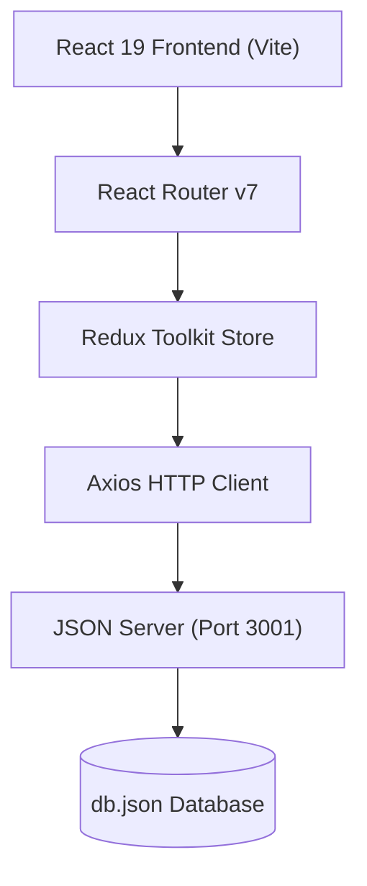

* **Frontend:** React 19, Vite, Bootstrap 5.3, React Bootstrap, Remix Icons, Font Awesome.
* **State Management:** Redux Toolkit (`auth.slice.js` for session management and `appointment.slice.js` for slot/appointment workflows).
* **Storage:** Browser `localStorage` for session persistence across page refreshes.
* **Mock REST Backend:** `json-server` running on port `3001` with full CRUD support for users, slots, and appointments.

---

## User Workflows

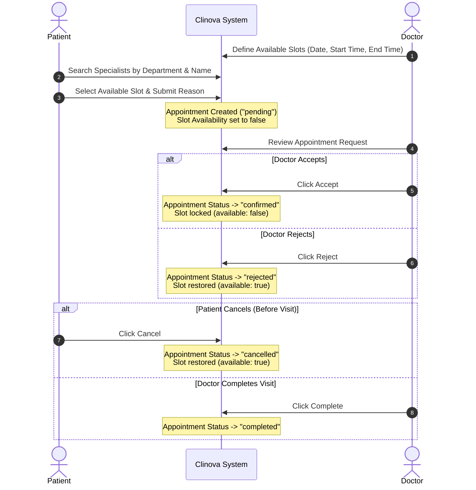

---

## Application Screenshots & Dashboard Walkthrough

### 1. Public Discovery

#### Home Page (Hero Section)
The landing page introduces Clinova's healthcare network with high-contrast typography, brand navigation, and instant links to registration and specialist directories.

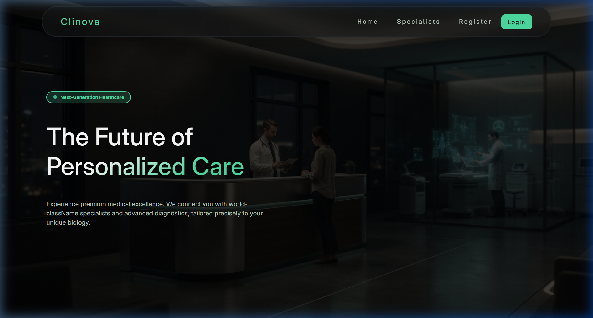

#### Specialists Directory (`/specialists`)
Displays top medical faculty ranked by clinical experience, credential badges, and consultation fees.

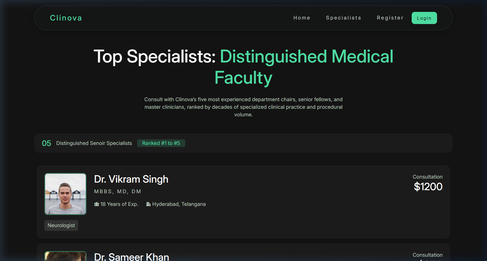

---

### 2. Patient Experience (Dev Mahida)

#### Patient Dashboard (`/dashboard/patient/home`)
When logged in as patient **Dev Mahida**, the dashboard serves as the command center for personal healthcare:
* **Profile Overview:** Quick access to contact information and location with a direct link to profile editing.
* **Upcoming Appointments:** Displays upcoming confirmed bookings with doctor ID, date, time, and submitted clinical complaint.
* **Past Appointments:** Archive of completed past visits.
* **Cancelled Appointments:** Record of retracted visits.

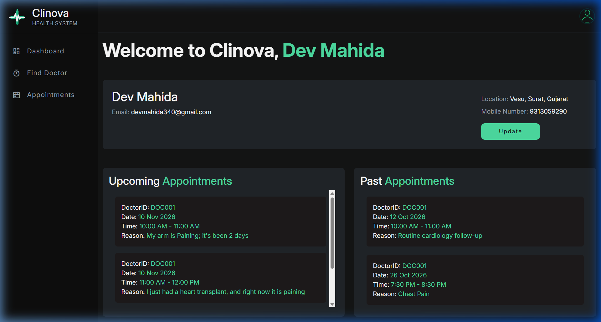

#### Find Doctors & Search Filters (`/dashboard/patient/find-doctors`)
Patients can filter doctors by specialization drop-down (Cardiologist, Dermatologist, Orthopedic, Pediatrician, etc.) or search dynamically by doctor name with pagination controls.

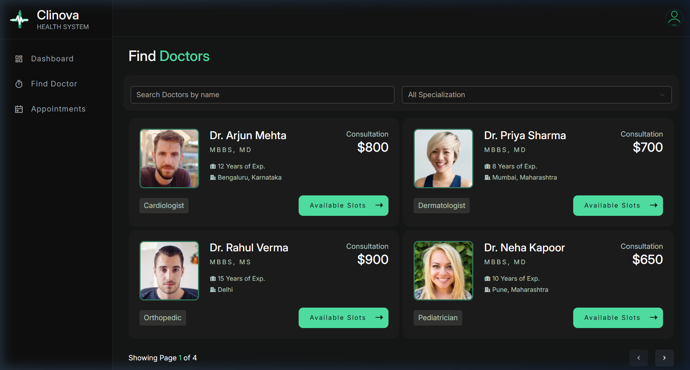

#### Slot Booking Modal
Clicking **Available Slots** opens the interactive reservation modal displaying real-time open slots. Patients select a time slot and input their symptoms or reason for visit.

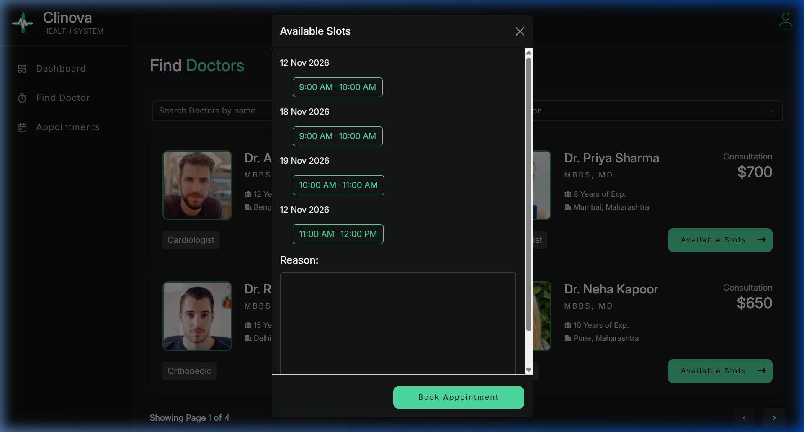

#### My Appointments Management (`/dashboard/patient/my-appointments`)
A real-time tabular overview of all appointments booked by the patient. Patients can monitor confirmation statuses and cancel any active appointment with a single click.

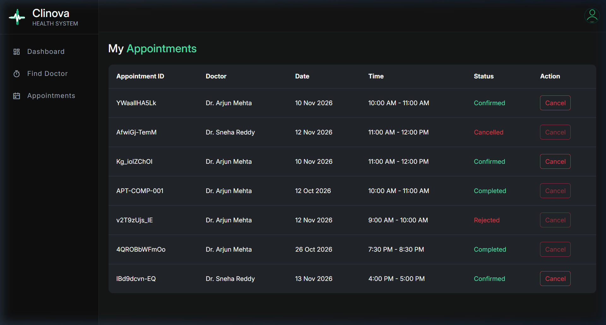

---

### 3. Doctor Portal (Dr. Arjun Mehta)

#### Doctor Dashboard (`/dashboard/doctor/home`)
When logged in as **Dr. Arjun Mehta**, the doctor portal provides immediate clinical oversight:
* **Doctor Profile Card:** Summarizes clinical experience, qualifications, and department affiliation.
* **KPI Metrics Counters:** 
  * **Pending Requests:** Real-time count of patient requests awaiting doctor triage.
  * **Confirmed Appointments:** Scheduled visits confirmed on the calendar.
  * **Completed Consultations:** Visits conducted and documented.
  * **Today's Consultations:** Urgent count of patients scheduled for the current day.

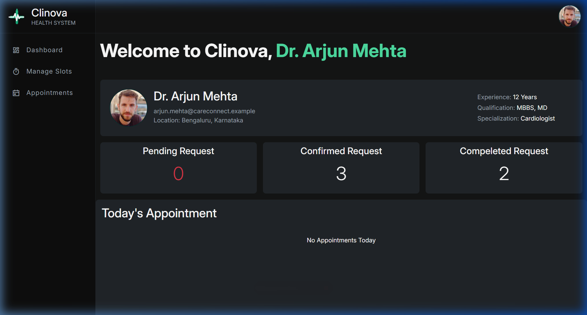

#### Availability & Clinic Hours (`/dashboard/doctor/manage-slots`)
Doctors maintain their weekly clinic availability:
* **Slot Listing Table:** Displays start time, end time, date, and visual availability status indicators (`green` for open, `red` for booked).
* **Add Slots Modal:** Allows doctors to publish new slots for future dates with strict time validation.
* **Deletion Protection:** Doctors can remove unused slots, while active booked slots are protected against accidental deletion.

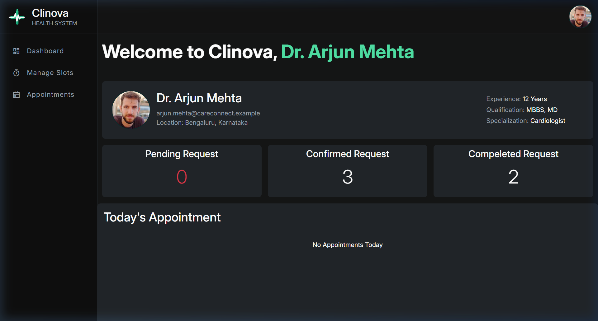

#### Add Slot Modal
Modal dialog enabling doctors to schedule clinic hours:

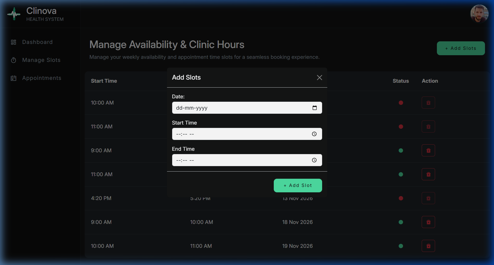

#### Doctor Appointments Triage (`/dashboard/doctor/appointments`)
The appointment control center displays patient name, contact details, date, time, and consultation reason:
* **Accept:** Confirms the patient's appointment and confirms the slot reservation.
* **Reject:** Declines the request and immediately returns the time slot to the public pool.
* **Complete:** Marks an ongoing or conducted visit as completed once the patient has been seen.

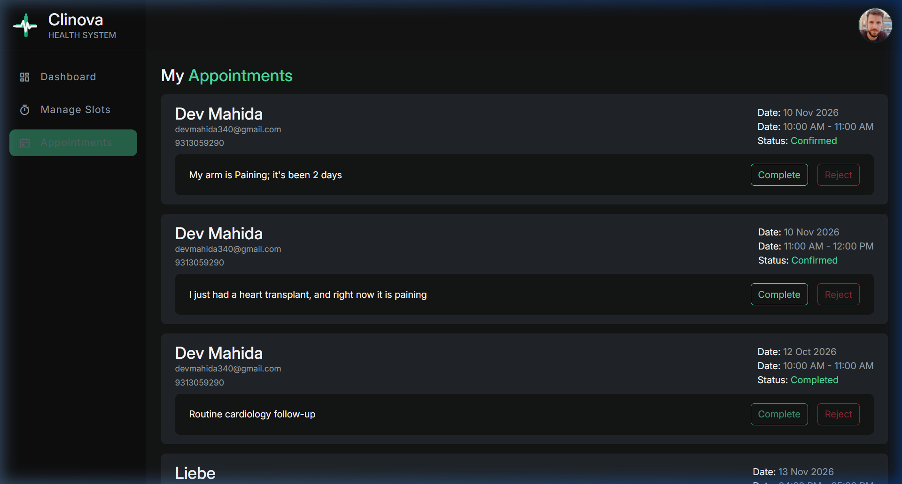

---

## Getting Started

### Prerequisites
* [Node.js](https://nodejs.org/) (version 18.0.0 or higher)
* [npm](https://www.npmjs.com/) (version 9.0.0 or higher)

### Installation
Clone the repository and install dependencies:

```bash
git clone https://github.com/DevMahida/Clinova.git
cd Clinova
npm install
```

### Running the Application

Clinova requires both the **Mock REST API** (`json-server`) and the **Vite Development Server** to be running concurrently:

#### 1. Start the JSON Server
In your first terminal, start the backend on port `3001`:
```bash
npm run server
```
*API endpoints will be live at `http://localhost:3001/` (`/users`, `/slots`, `/appointments`).*

#### 2. Start the Vite Frontend
In a second terminal, launch the client server:
```bash
npm run dev
```
*The web application will open at `http://localhost:5173/`.*

### Demo Credentials

| Role | Name | Email | Password |
| :--- | :--- | :--- | :--- |
| **Patient** | Dev Mahida | `devmahida340@gmail.com` | `LiebeXDev@2005` |
| **Doctor** | Dr. Arjun Mehta | `arjun.mehta@careconnect.example` | `doc001@Care2026!` |

---

## Available Scripts

| Command | Description |
| :--- | :--- |
| `npm run dev` | Starts the Vite development server at `http://localhost:5173` |
| `npm run server` | Starts JSON Server watching `db.json` on port `3001` |
| `npm run build` | Compiles an optimized production build into the `dist/` folder |
| `npm run preview` | Serves the local production build for preview |
| `npm run lint` | Runs ESLint across the codebase |

---

## Project Structure

```text
Clinova/
├── db.json                     # Local mock database (users, doctors, slots, appointments)
├── index.html                  # HTML5 entry template with typography and icon CDNs
├── package.json                # Project dependencies and npm scripts
├── vite.config.js              # Vite configuration
├── public/
│   ├── favicon.png             # Application logo
│   ├── PRD.pdf                 # Official Product Requirements Document
│   └── screenshots/            # Live application UI screenshots
└── src/
    ├── main.jsx                # Application entry point (Redux Provider & BrowserRouter)
    ├── App.jsx                 # Route declarations & ToastContainer setup
    ├── index.css               # Design system tokens, color palettes & utilities
    ├── store/
    │   └── store.js            # Redux store configuration
    ├── features/
    │   ├── auth.slice.js       # User auth, registration, profile updates & doctor fetching
    │   └── appointment.slice.js# Slot availability, creation, deletion & appointment status
    ├── utils/
    │   ├── Protected.jsx       # Route authentication guard (redirects unauthenticated to /login)
    │   └── ProtectedHome.jsx   # Doctor routing utility
    ├── pages/
    │   ├── Home.jsx            # Landing page
    │   ├── Specialists.jsx     # Ranked doctor faculty catalog
    │   ├── Login.jsx           # Portal login (Patients & Doctors)
    │   ├── RegisterUser.jsx    # Patient registration form with validation
    │   └── DashboardLayout.jsx # Authenticated frame: role redirects, Sidebar, Header, & Main Outlet
    └── components/
        ├── home/
        │   ├── Header.jsx      # Public navigation bar
        │   ├── HeroSection.jsx # Hero banner and tagline
        │   ├── Title.jsx       # Section header for specialists
        │   └── DoctorList.jsx  # Ranked specialist cards with consultation fee
        └── Dashboard/
            ├── Header.jsx      # Topbar with profile avatar & logout handler
            ├── Sidebar.jsx     # Role-based sidebar navigation
            ├── Main.jsx        # Dashboard outlet wrapper
            ├── patient/
            │   ├── PatientDashboard.jsx   # Patient overview (Upcoming, Past & Cancelled visits)
            │   ├── FindDoctor.jsx         # Specialist directory, department filter & booking modal
            │   ├── patientAppointment.jsx # Appointments management table with cancel action
            │   └── Update.jsx             # Profile edit form
            └── dcotor/
                ├── DashboardHome.jsx      # Doctor overview (Profile summary & KPI counters)
                ├── ManageSlots.jsx        # Weekly availability slots table & Add Slot modal
                └── Appointments.jsx       # Doctor triage feed with Accept, Reject & Complete actions
```

---

<p align="center">
  Developed with ❤️ for <strong>Clinova Health System</strong>.
</p>
